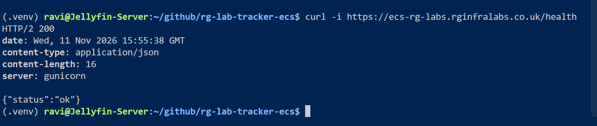
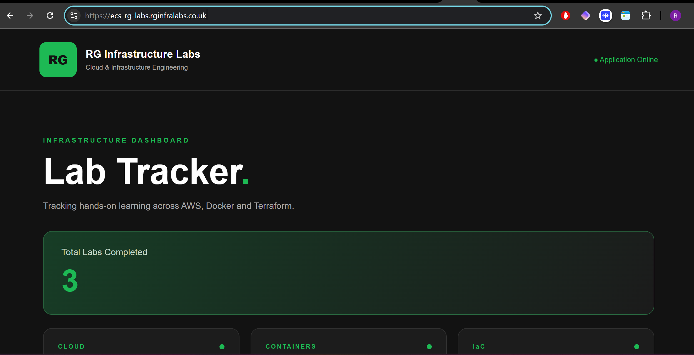
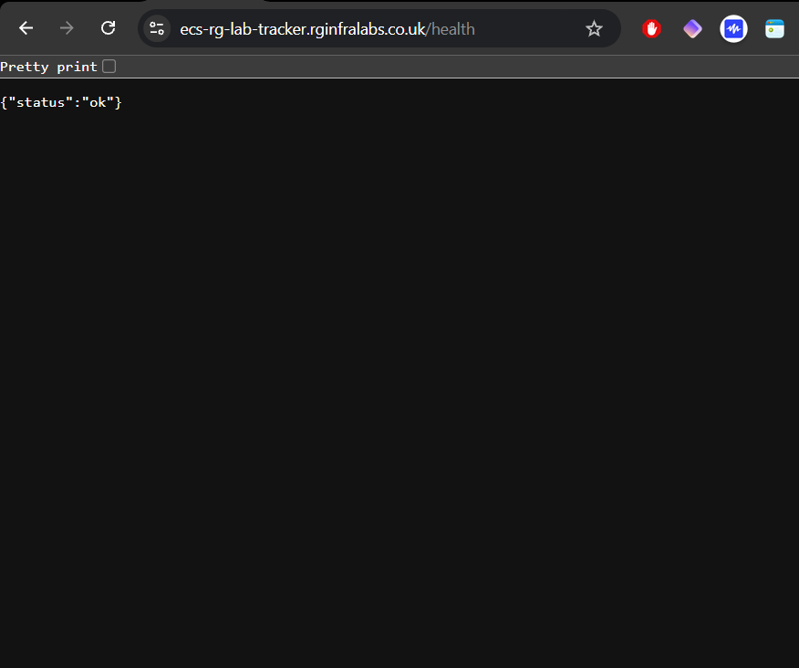
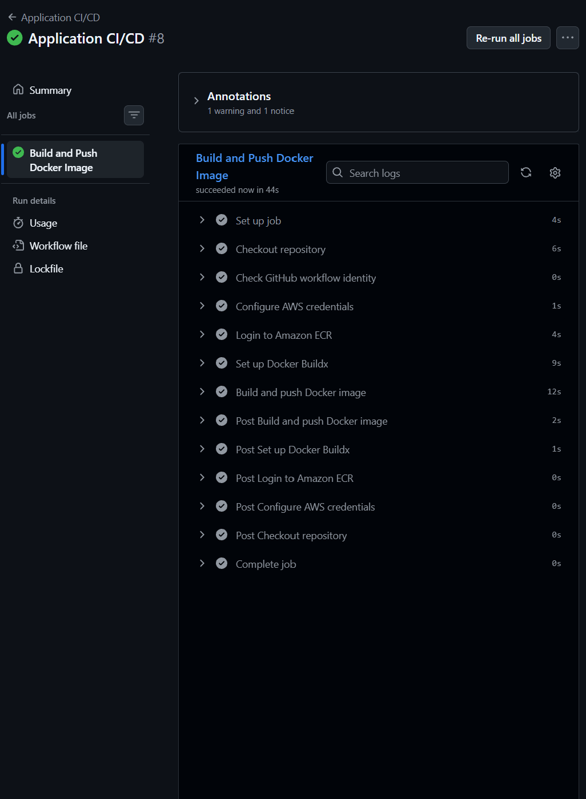
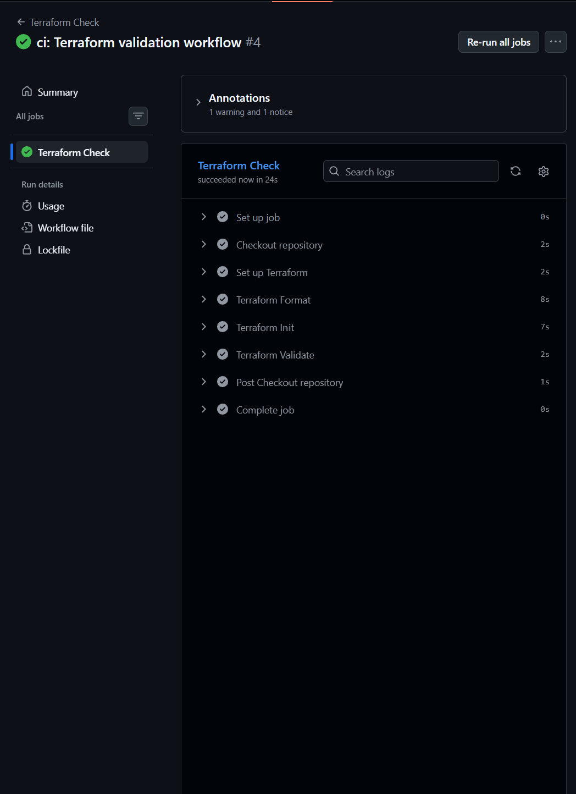

# RG Lab Tracker — ECS

## Objective

Build, containerise and deploy a custom lab tracking application using Docker, Terraform and AWS ECS Fargate, with HTTPS and a custom domain. Demonstrating a production-style deployment workflow.

## Project Overview

This project involves building RG Lab Tracker, a Python Flask application that tracks completed AWS, Docker and Terraform labs through a web dashboard.

I built the application locally using Flask and Redis to store lab counts, with a custom green and black interface using my RG Infrastructure Labs branding.

I then containerised the application using a multi-stage Dockerfile, running Gunicorn as the application server under a non-root user.

I  first built the AWS infrastructure manually using the AWS Console before recreating it with Terraform and automating deployments using GitHub Actions.

### Redis and Gunicorn

I used Redis and Gunicorn alongside my Flask application to support the deployment on AWS ECS Fargate.

**Redis** runs as a separate container within the same ECS task, providing an in-memory data store for the application's lab tracking data.

**Gunicorn** I initially planned to use NGINX , Thats why the footer says nginx. Gunicorn acts as the production WSGI server, running my Flask application on port 5000 with two worker processes. The Application Load Balancer forwards incoming requests to Gunicorn, which handles them and passes them to Flask.

Both services run together within my ECS task.

**Build documentation showing how I built the project Locally on my machine and the AWS Console:** [build.md](build.md) — documenting  local development and Docker to deployment through the AWS Console.

### VPC Networking

I used Terraform to provision a VPC (`10.0.0.0/16`) with three public and three private subnets across three Availability Zones in AWS Stockholm (`eu-north-1`).

Public subnets route traffic through an Internet Gateway, while private subnets use a NAT Gateway for outbound internet access.

I chose a single NAT Gateway to reduce costs and keep the infrastructure simple for this learning project. In production, I would consider deploying one per Availability Zone to improve resilience and reduce cross-zone dependencies.

### Security Groups

I used Terraform to create two security groups to control traffic between the Application Load Balancer (ALB) and ECS Fargate tasks.

The ALB security group allows inbound HTTP (80) and HTTPS (443) traffic from the internet. The ECS security group only accepts inbound traffic on port 5000 from the ALB security group, where Gunicorn serves my Flask application.

Both security groups allow outbound traffic. This configuration keeps the application inaccessible directly from the internet while allowing traffic through the load balancer.

### Application Load Balancer (ALB)

I created an Application Load Balancer using a separate Terraform module, deploying it across three public subnets. The ALB uses its own security group to allow inbound HTTP (80) and HTTPS (443) traffic.

I also configured a target group using port 5000 to route traffic to the ECS containers, with health checks using the `/health` endpoint.

Finally, I added an HTTP listener on port 80 that automatically redirects incoming requests to HTTPS on port 443 using a 301 redirect.

### AWS Certificate Manager (ACM)

I created a Terraform ACM module to provision an SSL/TLS certificate for `ecs-rg-lab-tracker.rginfralabs.co.uk`. The certificate uses DNS validation through Route 53, allowing AWS to verify domain ownership automatically. I configured `create_before_destroy` to support certificate replacement without removing the existing certificate first. The validated certificate is attached to the Application Load Balancer's HTTPS listener on port 443, enabling encrypted connections to the application.

### Amazon Route 53

I created a Terraform Route 53 module that references my existing `rginfralabs.co.uk` hosted zone rather than creating a new one. The module automatically creates the DNS records required for ACM certificate validation. I also configured an A alias record for `ecs-rg-lab-tracker.rginfralabs.co.uk`, pointing to the Application Load Balancer. This allows users to access the application through my custom domain, with HTTP requests redirected to HTTPS.

### IAM – ECS Task Execution Role

I created a dedicated IAM module to manage the ECS task execution role, attaching the AWS-managed AmazonECSTaskExecutionRolePolicy.

This allows ECS Fargate to authenticate with Amazon ECR, pull container images and send logs to CloudWatch when logging is configured.

I separated IAM into its own Terraform module to keep permissions independent of the ECS infrastructure and make the configuration easier to maintain.

### ECS Fargate – Application Deployment

I used Terraform to deploy my Lab Tracker application on Amazon ECS Fargate, creating an ECS cluster, task definition and service.

Fargate allows me to run containers without provisioning or managing EC2 instances, while Terraform manages the infrastructure.

The task definition contains two containers:

Flask/Gunicorn: Runs the Lab Tracker application on port 5000.

Redis 7 Alpine: Runs on port 6379 and stores application counters.

Both containers run within the same Fargate task, allowing Flask to communicate with Redis using 127.0.0.1.

I configured the ECS service with a desired count of one task, using three private subnets and an ECS security group that only permits application traffic from the ALB on port 5000.

The Application Load Balancer forwards incoming HTTPS requests to Gunicorn, while the NAT Gateway provides outbound connectivity for the private subnets.

### HTTPS Browser and Terminal Verification  

**Application:** https://ecs-rg-lab-tracker.rginfralabs.co.uk

**Health Check:** https://ecs-rg-lab-tracker.rginfralabs.co.uk/health

Terminal verification 



HTTPS Browser Verification 



Health Browser Validation 



## AWS Systems Manager Parameter Store (Bonus)

I created a Terraform SSM module to manage the application's environment configuration.

I stored `production` as a String parameter at `/rg-lab-tracker-ecs/app_env` and configured the ECS task definition to inject it into the Flask container as `APP_ENV`.

I also added a least-privilege IAM policy allowing the ECS task execution role to retrieve the specific parameter.

I verified the parameter using AWS CLI, confirmed the ECS service was running task definition revision `:4` with one running task, and successfully tested the HTTPS `/health` endpoint.

## CI/CD Pipeline

### Application – Build and Push Docker Image

I created a GitHub Actions workflow to automate building and publishing the RG Lab Tracker Docker image.

The pipeline runs when application code or the Dockerfile is updated on the main branch.

It checks out the repository, authenticates with AWS using IAM and GitHub OIDC, and logs into Amazon ECR.

Docker Buildx then builds the application image and pushes it to ECR using the Git commit SHA as a unique image tag.

**Result:** The pipeline completed successfully, confirming automated image publishing to Amazon ECR.



### Terraform Check Pipeline

I created a GitHub Actions workflow to automatically validate my Terraform infrastructure code whenever changes are pushed to the main branch or submitted through a pull request.

The pipeline performs three checks:

- **Terraform Format** – Checks that Terraform files follow consistent formatting.
- **Terraform Init** – Initialises Terraform without connecting to the remote backend.
- **Terraform Validate** – Checks the configuration for syntax and structural errors.

All checks passed successfully, confirming the Terraform configuration is valid before infrastructure deployment.




## Local Setup

### Prerequisites

- Docker and Docker Compose
- Git

### 1. Clone the repository

```bash
git clone https://github.com/Wutang-Dev/rg-lab-tracker-ecs.git
cd rg-lab-tracker-ecs
```

### 2. Build the application image

```bash
docker build -t rg-lab-tracker:v1.0.0 .
```

### 3. Start Redis

```bash
docker network create lab-tracker-network

docker run -d \
  --name lab-tracker-redis \
  --network lab-tracker-network \
  redis:7-alpine
```

### 4. Start the Flask application

```bash
docker run -d \
  --name lab-tracker-app \
  --network lab-tracker-network \
  -p 5000:5000 \
  -e REDIS_HOST=lab-tracker-redis \
  rg-lab-tracker:v1.0.0
```

The application runs using Gunicorn on port 5000.

### 5. Verify the application

Open the application:

http://localhost:5000

Check the health endpoint:

```bash
curl http://localhost:5000/health
```

Expected response:

```json
{"status":"ok"}
```

### 6. Clean up

```bash
docker rm -f lab-tracker-app lab-tracker-redis
docker network rm lab-tracker-network
```