# Local Build 

I built the App locally on my machine first 

## docker build 

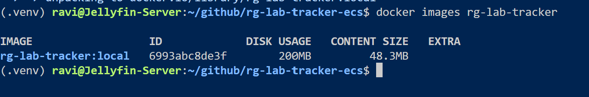

## local health check 

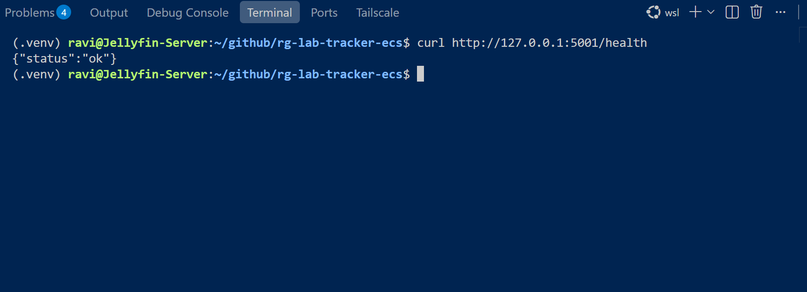

## local api check 

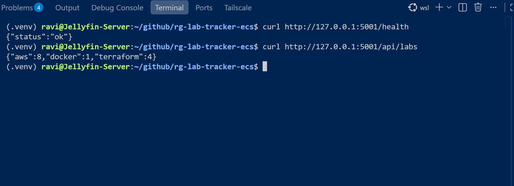

## local browser check

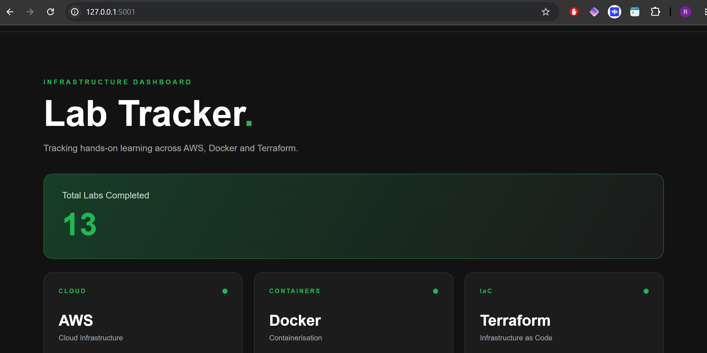

## Push App to Docker Hub

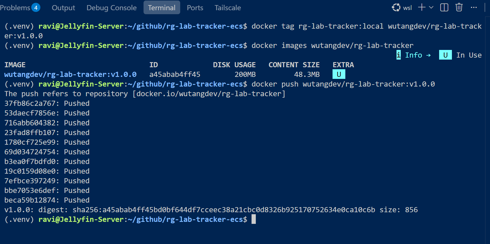

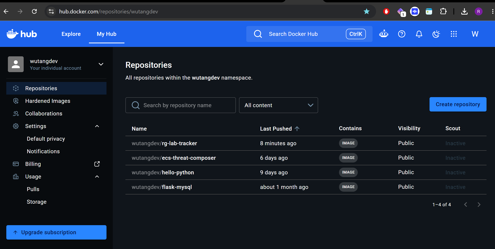

## Create ECR Container in AWS 

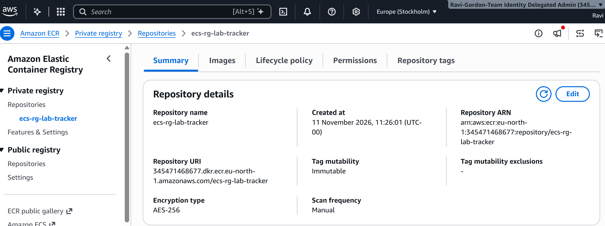

## Push App to ECR Container

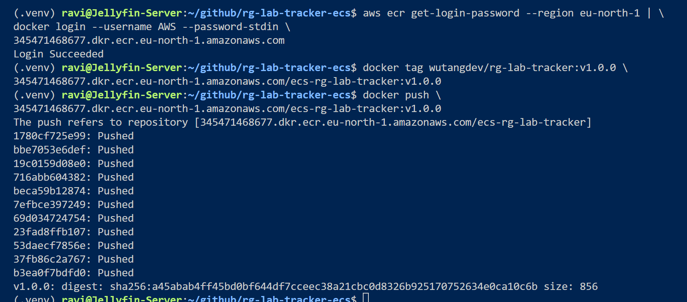

verified in the AWS console 

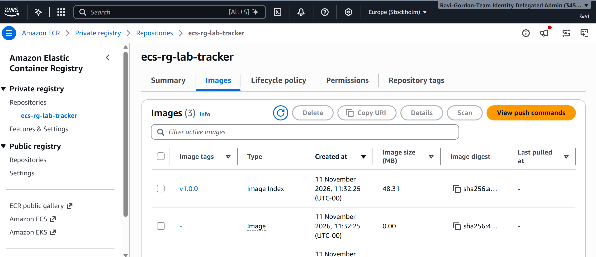

# AWS Console Build 

## ECS Cluster Creation 

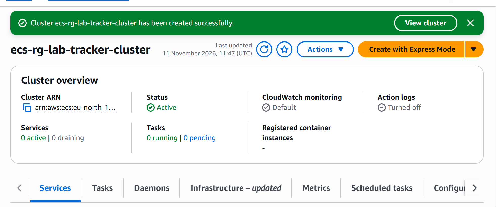

## ECS Task Definitions 

I created an ECS Fargate task definition (`ecs-rg-lab-tracker-task:1`) containing two containers: Flask/Gunicorn to serve the application on port 5000 and Redis to store lab counts on port 6379. I configured the environment variables, task execution role, and shared CPU and memory resources.

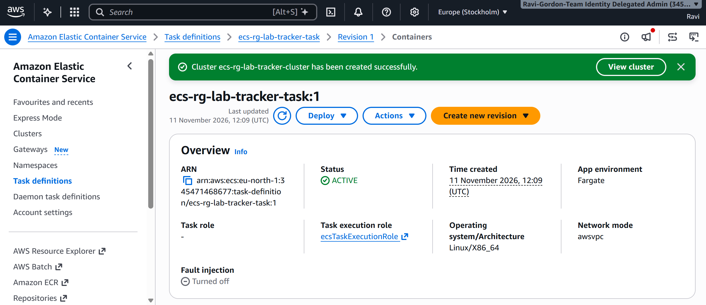

## VPC 

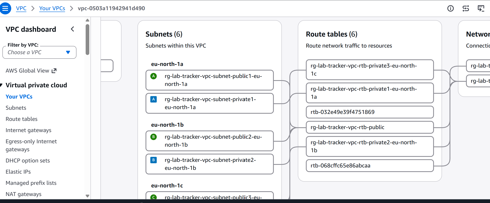

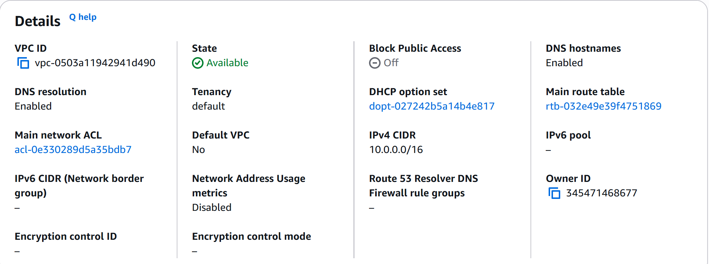

## Security Groups 

rg-lab-tracker-alb-sg - Allow HTTP and HTTPS traffic to ALB

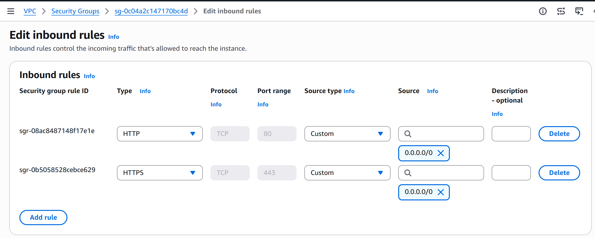

rg-lab-tracker-ecs-sg - Allow ALB traffic to Flask application

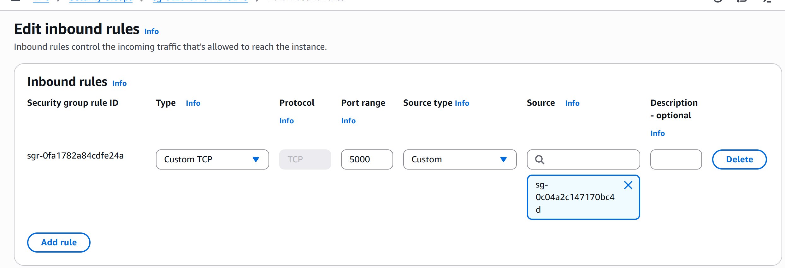

## Aplication Load Balancer

target group 

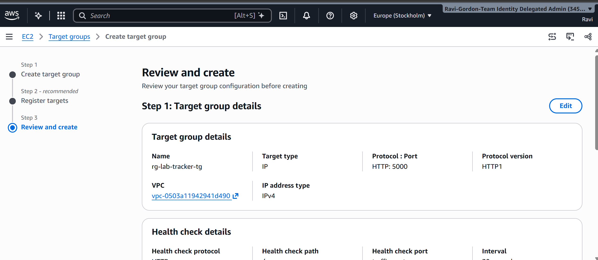

Application load balancer 

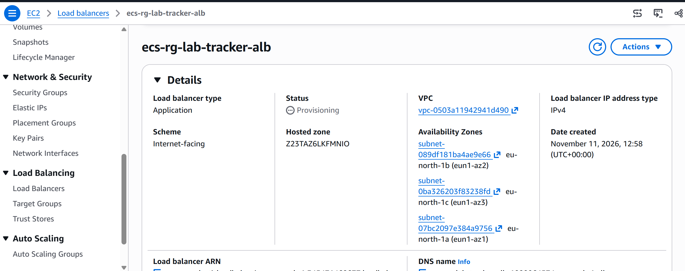

## ECS Fargate Service 

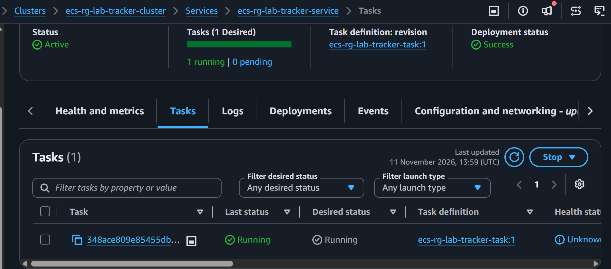

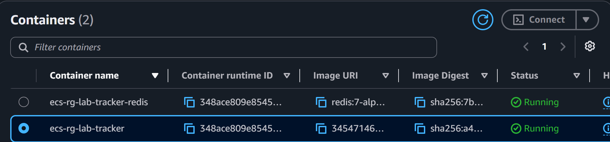

## Connect the ECS service to the target group

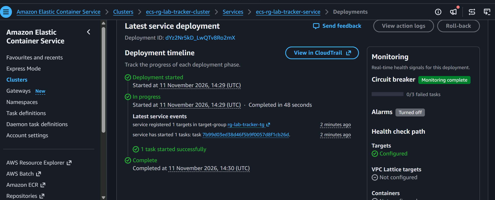

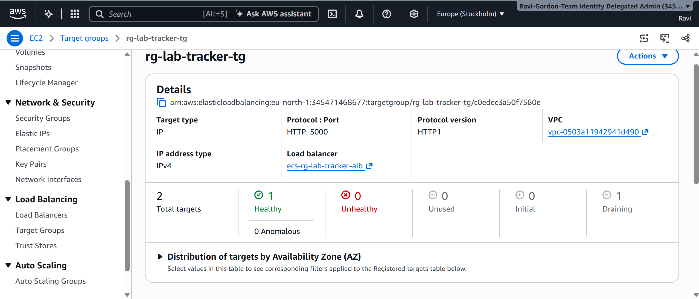

## Verify the target is healthy

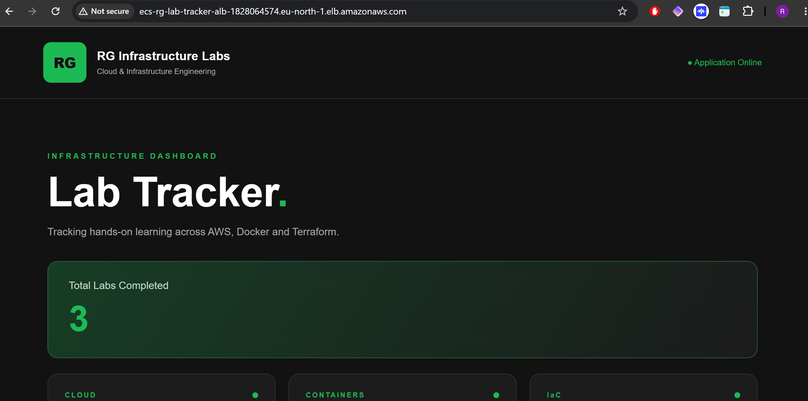

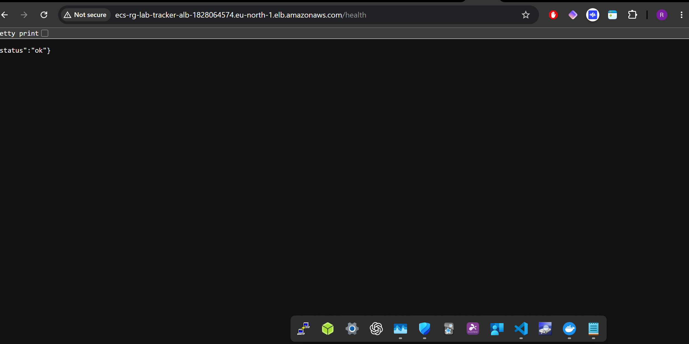

## Request an SSL/TLS certificate

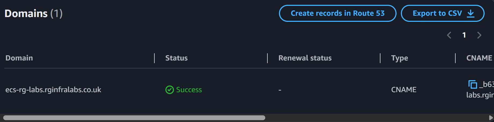

## Configure HTTPS on the Application Load Balancer

HTTPS Listener

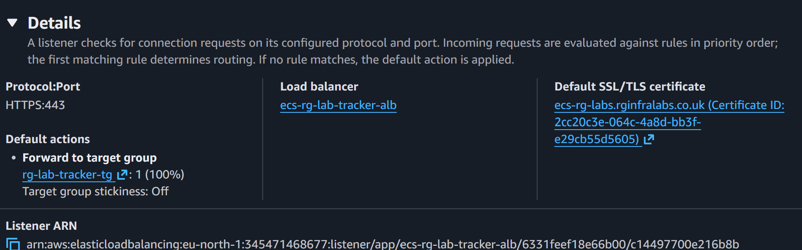

## Configure the HTTP redirect

[HTTP Redirect](images/30-http-redirect.png)

## Configure Route 53

[A Record](images/31-A-record.png)

terminal varification 

[Terminal Verification](images/32-terminal-verify.png)

## HTTPS Browser verification

[HTTPS Browser verification](images/33-https-browser-verify.png)
